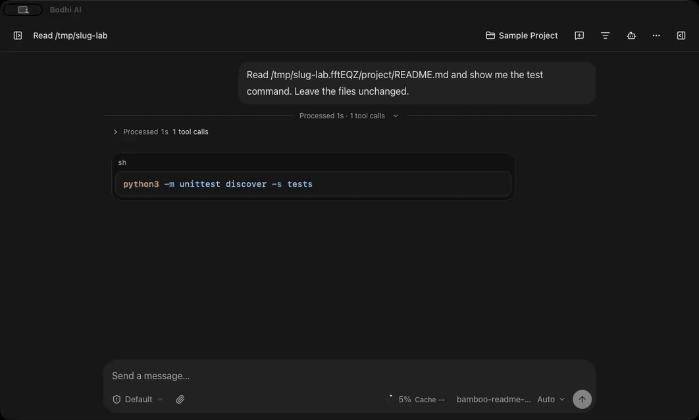

# Bodhi AI

[Download Bodhi](https://github.com/bigduu/Bodhi-AI/releases/latest) · [简体中文](README.zh-CN.md)

Bodhi is an open-source desktop agent for your projects. Pick a folder and a model, then ask it to read files, run commands, or make changes. Review its tool calls and approvals in the chat.



Recorded in Bodhi 2026.11.39 on macOS with a local model and a sample project.

## Install

The release has installers for Apple Silicon Macs (macOS 13.5+), Windows x64 and ARM64, and Linux x64 and ARM64.

On Apple Silicon Macs or APT-based Linux x64, you can also install from the terminal.

```sh
curl -q --proto '=https' --proto-redir '=https' --tlsv1.2 -fsSL https://bigduu.github.io/Pavilion/install.sh | sh
```

[Homebrew and download troubleshooting](docs/download-settings.md#english)

## Run your first task

1. Open Bodhi and wait for the components to download.
2. Open **Settings → Provider**. Add a provider, enter its key, add a model, and save. Under **Default model preferences**, choose it for **Chat**, then select **Verify and use model** or **Save preferences**, as shown.
3. Open a conversation and pick a project folder. Try this with a project that documents its test command.

   > Read this project's README and tell me the command to run its tests. Leave the files unchanged.

Sessions are saved on your computer. The model provider and remote tools you set up may receive task data.

## Docs

[Download settings](docs/download-settings.md#mirrors-and-proxies) · [Updates and rollback](docs/component-releasing.md#applying-an-update-in-bodhi) · [Build from source](docs/development.md) · [Bamboo runtime](https://github.com/bigduu/Bamboo-agent) · [MIT](LICENSE)
