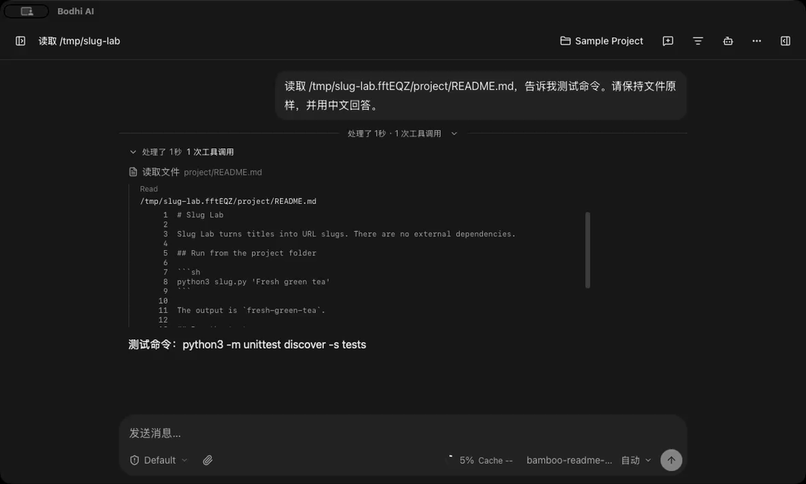

# 菩提 Bodhi AI

[下载菩提](https://github.com/bigduu/Bodhi-AI/releases/latest) · [English](README.md)

菩提是一个开源桌面应用。选个项目文件夹，接上自己的模型，就可以让它读文件、跑命令或修改项目。它调用了什么工具、哪些操作需要你批准，都能在会话里看到。



实录来自 macOS 上的菩提 2026.11.39，使用本机模型和示例项目。

## 安装

发布页提供 Apple Silicon Mac（macOS 13.5 及以上）、Windows x64 和 ARM64、Linux x64 和 ARM64 的安装包。

Apple Silicon Mac 和使用 APT 的 Linux x64 也可以用这条命令安装。

```sh
curl -q --proto '=https' --proto-redir '=https' --tlsv1.2 -fsSL https://bigduu.github.io/Pavilion/install.sh | sh
```

[Homebrew 和下载问题](docs/download-settings.md#简体中文)

## 跑第一个任务

1. 打开菩提，等组件下载完成。
2. 打开「设置 → 提供方」，新增提供方，填入密钥，添加模型并保存。在「默认模型偏好」里把它选为对话模型，再根据界面提示点击「验证并使用模型」或「保存偏好」。
3. 新建会话，选一个在 README 里写了测试命令的项目，发送这句话。

   > 读取这个项目的 README，告诉我运行测试的命令。请保持文件原样。

会话保存在本机。你配置的模型提供方和远程工具可能收到任务数据。

## 文档

[下载设置](docs/download-settings.md#镜像与代理) · [更新和回滚](docs/component-releasing.md#applying-an-update-in-bodhi) · [源码开发](docs/development.zh-CN.md) · [班布运行时](https://github.com/bigduu/Bamboo-agent) · [MIT](LICENSE)
